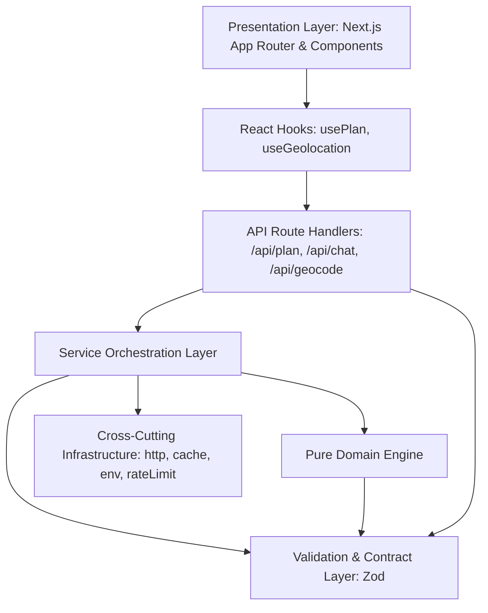
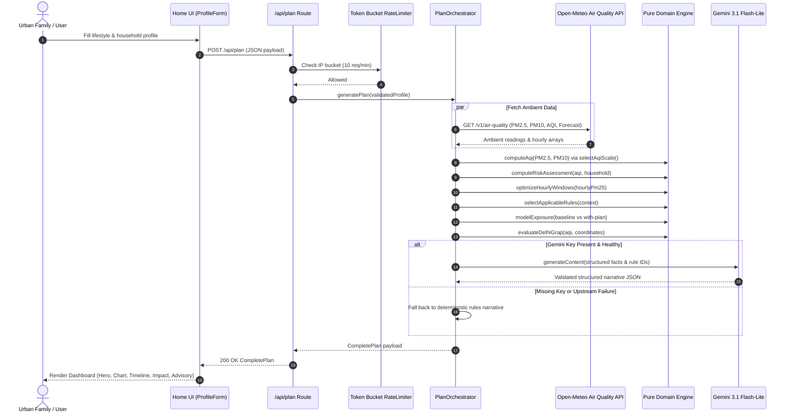

# SmogShield — Architectural Blueprint & ADRs

SmogShield is designed according to **Hexagonal / Clean Architecture** principles, enforcing strict unidirectional dependency flow, absolute boundary separation, and zero mathematical hallucinations.

---

## 🏛️ System Layering & Dependency Rules

### Layer Boundary Constraints

1. **`src/domain/` (Pure Business Logic):**
   - **Zero I/O:** No network calls, filesystem access, timers, or random number generators.
   - **Zero Framework Coupling:** Must not import from `react`, `next`, or `src/services/`.
   - **100% Deterministic:** Every function produces the exact same output for given inputs.
   - **Mathematical Authority:** All particulate calculations, breakpoints, risk tiers, and exposure estimates originate exclusively here.

2. **`src/services/` (Orchestration & Side Effects):**
   - Implements dependency injection for all external I/O (`fetch`, `@google/genai`).
   - Glues domain calculation outputs with ambient weather feeds and Gemini structured prompt payloads.
   - Manages fallbacks and error transitions transparently.

3. **`src/schemas/` (Single Source of Truth):**
   - All runtime shapes validated using Zod.
   - TypeScript types derived strictly via `z.infer<typeof Schema>`.
   - Reused across API boundaries, service layers, and presentation components.

4. **`src/lib/` (Technical Infrastructure):**
   - Server-only environment validation with `import "server-only"`.
   - Resilient HTTP fetcher with 8s timeout (`AbortController`) and exponential backoff retry.
   - In-memory token-bucket rate limiter and TTL coordinate cache.
   - Structured JSON logging stripped of PII.

---

## 🔄 End-to-End Execution Flow

---

## 📋 Architectural Decision Records (ADRs)

### ADR 1: Hybrid "Rules Compute, AI Explains" Pipeline

- **Status:** Accepted
- **Context:** Large language models frequently hallucinate mathematical calculations, invent non-existent pollutant thresholds, or miscalculate particulate exposure percentages.
- **Decision:** Split computation and narrative into distinct phases. All numbers (AQI sub-indices, percentage reduction, inhaled particulate dose in $\mu\text{g}$, Berkeley Earth cigarette equivalence, CO2 savings) are computed strictly by deterministic TypeScript domain functions. Gemini (`gemini-3.1-flash-lite`) receives pre-computed facts and rule IDs, focusing solely on compassionate, plain-language explanation and schedule formatting.
- **Consequences:** Eliminates quantitative hallucinations; ensures 100% reproducible unit tests; provides automatic offline fallback when the LLM is unavailable.

### ADR 2: Keyless Open-Meteo Ambient & Geocoding Feeds

- **Status:** Accepted
- **Context:** Traditional air quality APIs require commercial API tokens, enforce strict developer quotas, or restrict non-commercial usage.
- **Decision:** Use Open-Meteo's open atmospheric chemistry models (CAMS and SILAM integration) and Open-Meteo Geocoding API. Both require no API keys, support worldwide coordinates, and provide hourly forecast data.
- **Consequences:** Zero onboarding friction; immediate deployment capability on Vercel without third-party weather keys.

### ADR 3: Pure Inline Accessible SVG Over Heavy Charting Libraries

- **Status:** Accepted
- **Context:** Third-party charting packages (e.g., Chart.js, Recharts, Victory) add 150–350 kB of JavaScript to the client bundle and often suffer from accessibility defects.
- **Decision:** Implement a custom 24-hour PM2.5 trend line using an accessible inline `<svg>` element with `<title>`, semantic landmarks, and an optional toggleable HTML `<table>` for assistive screen readers.
- **Consequences:** First-load shared JavaScript is kept under 105 kB; zero third-party chart dependencies; 100% WCAG 2.2 AA compliance.

### ADR 4: Privacy-First Coordinate Truncation

- **Status:** Accepted
- **Context:** Browser geolocation can disclose precise residential street addresses, posing privacy risks when sent to backend servers.
- **Decision:** All latitude and longitude coordinates obtained from browser geolocation or geocoding lookups are rounded to 2 decimal places prior to caching or server submission.
- **Consequences:** Maintains approximately $1.1\,\text{km}$ spatial resolution—optimal for regional atmospheric modeling while protecting precise user residence privacy.

### ADR 5: Token-Bucket In-Memory Rate Limiting

- **Status:** Accepted
- **Context:** Public web APIs are vulnerable to scraping, Denial-of-Service attacks, and LLM quota exhaustion.
- **Decision:** Implement a token-bucket rate limiter per client IP in `src/lib/rateLimit.ts` enforcing a strict threshold of 10 requests per minute.
- **Consequences:** Prevents client flooding and abuse in single-instance and serverless environments. In high-traffic multi-region production, this can seamlessly bind to Upstash Redis or Vercel KV.
