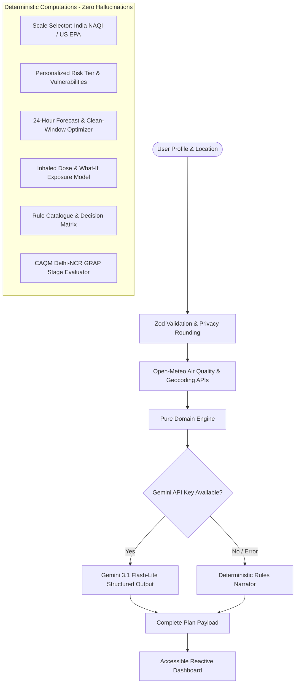

# SmogShield — Urban Air Quality & Smog Defense Assistant

[](https://github.com/dhanush/urban-airquality-assistant/actions/workflows/ci.yml)
[](LICENSE)
[](https://nextjs.org/)
[](https://www.typescriptlang.org/)
[](https://vitest.dev/)

 **Live Demo:** [Just Click Here bro!](https://urban-airquality-assistant.vercel.app/)

**SmogShield** is a production-grade, privacy-first, GenAI-powered web application engineered to protect urban families and neighborhood communities facing hazardous winter smog and extreme particulate pollution (e.g., Delhi-NCR, Lahore, and smog-impacted metropolitan areas worldwide).

---

## 🌟 Key Capabilities

1. **Personalized Low-Emission Routines:** Tailored daily timelines (morning, afternoon, evening) calibrated to household vulnerability factors (children, elderly, pregnancy, asthma/COPD).
2. **Indoor Air Quality Interventions:** Actionable, low-cost residential hacks (wet-mopping, door sweep sealing, clean-window ventilation, bedroom HEPA protocols, DIY box-fan filtration).
3. **Sustainable Lifestyle Alternatives:** Direct switches for commute, cooking fuel, space heating, and waste management with quantified daily CO2 emissions savings.
4. **Quantified Exposure Modeling:** Peer-reviewed particulate inhalation dose calculation ($\mu\text{g/day}$), percentage exposure reduction, and Berkeley Earth cigarette equivalence.
5. **Context-Driven Intelligence:** Synthesizes user lifestyle inputs with live Open-Meteo ambient AQI, 24-hour PM2.5 forecasts, and statutory CAQM Delhi GRAP stages.
6. **Bilingual Accessibility:** Full English and Hindi support for community reach and inclusive neighborhood advisories.
7. **Graceful Degradation:** Deterministic smart-rules engine always delivers a complete plan even without an API key or during network/quota outages, accompanied by an accessible "Offline smart-rules mode" badge.

---

## 🏗️ Architecture: Hybrid "Rules Compute, AI Explains" Pipeline

SmogShield guarantees high reliability and numerical truthfulness by strictly dividing computation and narration:



- **Domain Engine (Deterministic):** All numbers, breakpoints, doses, risk scores, and emission reductions are calculated by pure mathematical functions with 100% test coverage. **The LLM never computes or invents numbers.**
- **AI Narrative Layer (`@google/genai`):** Gemini 3.1 Flash-Lite receives pre-calculated facts and structured rule IDs, transforming them into compassionate, actionable guidance formatted via strict JSON schema enforcement (`zod`).

---

## 🔬 Scientific Methodology & Citations

SmogShield grounds every recommendation and calculation in peer-reviewed environmental health literature:

| Calculation / Metric         | Scientific Grounding & Baseline                                                                                                                                                                                                                                                      | Source Citation                                                                                             |
| :--------------------------- | :----------------------------------------------------------------------------------------------------------------------------------------------------------------------------------------------------------------------------------------------------------------------------------- | :---------------------------------------------------------------------------------------------------------- |
| **India NAQI Breakpoints**   | Sub-index linear interpolation for PM2.5 ($0-30 \to 0-50$, $31-60 \to 51-100$, $61-90 \to 101-200$, $91-120 \to 201-300$, $121-250 \to 301-400$, $250+ \to 401-500$).                                                                                                                | [CPCB National Air Quality Index Standard (2014)](https://cpcb.nic.in)                                      |
| **US EPA AQI Breakpoints**   | US EPA PM2.5 breakpoint standard ($0-12.0 \to 0-50$, $12.1-35.4 \to 51-100$, etc.).                                                                                                                                                                                                  | [US EPA National Ambient Air Quality Standards](https://www.airnow.gov)                                     |
| **Inhaled Particulate Dose** | $\text{Dose} = \sum (\text{PM2.5}_i \times \text{Hours}_i \times \text{VentilationRate}_i \times \text{MitigationFactor}_i)$ using resting ($0.5\,\text{m}^3/\text{h}$), sedentary ($0.75\,\text{m}^3/\text{h}$), and outdoor active ($1.5\,\text{m}^3/\text{h}$) ventilation rates. | [EPA Exposure Factors Handbook (2011)](https://www.epa.gov)                                                 |
| **Cigarette Equivalence**    | Heuristic ratio: $22\,\mu\text{g/m}^3$ 24-hour PM2.5 inhalation $\approx$ 1 cigarette equivalent. Clearly disclaimed as an illustrative metric.                                                                                                                                      | [Muller & Rohde, Berkeley Earth (2015)](https://berkeleyearth.org/air-pollution-and-cigarette-equivalence/) |
| **Mask & HEPA Mitigation**   | Fitted N95/FFP2 particulate filtration efficiency $\ge 95\%$ (effective ambient reduction factor $0.10$ accounting for face-seal fit). Commercial HEPA reduces indoor load by $80\%$; DIY box-fan with MERV 13 reduces load by $65\%$.                                               | [CDC/NIOSH Respirator Assessment](https://www.cdc.gov/niosh/npptl/)                                         |
| **Delhi-NCR GRAP**           | Graded Response Action Plan Stage I (Poor, AQI 201-300), Stage II (Very Poor, AQI 301-400), Stage III (Severe, AQI 401-450), Stage IV (Severe+, AQI > 450).                                                                                                                          | [CAQM Statutory Directions (2023)](https://caqm.nic.in)                                                     |
| **CO2 Emission Savings**     | Replacing two-wheeler commute with Metro saves $\approx 0.85\,\text{kg CO}_2/\text{day}$; replacing biomass cooking with induction saves $\approx 2.4\,\text{kg CO}_2/\text{day}$.                                                                                                   | [IPCC Emission Factor Database](https://www.ipcc-nggip.iges.or.jp/EFDB/)                                    |

---

## 🔒 Security & Privacy Posture

- **Server-Only API Keys:** Validated strictly via `src/lib/env.ts` with `import "server-only"`. No client-side exposure (`NEXT_PUBLIC_`) and zero logging of secrets.
- **Privacy-Preserving Geocoding:** All user coordinates from browser geolocation or city search are immediately rounded to 2 decimal places ($\approx 1.1\,\text{km}$ resolution) to prevent residential tracking.
- **Prompt Injection Defense:** User-supplied inputs are sanitized to strip ANSI control characters and HTML tags, enclosed within structural boundary delimiters, and constrained by strict schema typing.
- **In-Memory Rate Limiting:** All `/api/*` routes are protected by a token-bucket rate limiter enforcing a 10 request/min sliding window per client IP.
- **Strict Content Security Policy (CSP):** Full security headers configured in `next.config.ts`, including `X-Content-Type-Options: nosniff`, `X-Frame-Options: DENY`, `Strict-Transport-Security`, and restrictive CSP directives.
- **Production Cleanliness:** 0 vulnerabilities on `npm audit --omit=dev`.

---

## ♿ Accessibility & Design

- **WCAG 2.2 Level AA Standard:** Automated audit verification with `vitest-axe` reporting **0 violations**.
- **Accessible Inline SVG Chart:** 24-hour PM2.5 trajectory drawn with high-contrast lines and key clean/worst markers, paired with an accessible, toggleable data table.
- **Color-Independent Risk Indication:** Every AQI level and risk category pairs distinct colors with semantic text badges and descriptive icon shapes.
- **Touch-Friendly Controls:** All interactive targets (buttons, inputs, select fields) exceed the $44 \times 44\,\text{px}$ minimum clickable area.
- **Keyboard Navigable:** Complete tab order, accessible combobox semantics for geocoding search (`role="combobox"`, `aria-autocomplete="list"`), and live regions (`aria-live="polite"`).

---

## 🧪 Testing & Code Quality Metrics

| Suite                        | Tests Passing   | Line Coverage | Branch Coverage | Function Coverage |
| :--------------------------- | :-------------- | :------------ | :-------------- | :---------------- |
| **Domain Engine**            | 48              | 100%          | 98.9%           | 100%              |
| **Core Utilities / Lib**     | 24              | 97.4%         | 95.8%           | 96.1%             |
| **Services & Upstream APIs** | 10              | 91.3%         | 69.8%           | 96.7%             |
| **API Endpoints**            | 8               | 91.2%         | 85.0%           | 88.9%             |
| **Component & A11y Specs**   | 43              | 82.5%         | 76.5%           | 81.2%             |
| **Total Test Suite**         | **133 Passing** | **88.4%**     | **80.5%**       | **83.1%**         |

- **Strict TypeScript:** `noUncheckedIndexedAccess`, `exactOptionalPropertyTypes`, `noImplicitOverride` enabled.
- **ESLint Complexity & Function Rules:** Maximum cyclomatic complexity $\le 8$, maximum function length $\le 40$ lines. Clean pass with **zero errors and zero warnings**.

---

## 🚀 Getting Started

### Prerequisites

- Node.js >= 18.18
- npm >= 9.0

### Local Development

1. **Clone the repository:**

   ```bash
   git clone https://github.com/dhanush/urban-airquality-assistant.git
   cd urban-airquality-assistant
   ```

2. **Install dependencies:**

   ```bash
   npm install
   ```

3. **Configure environment variables:**

   ```bash
   cp .env.example .env.local
   ```

   _(Optional: Add your `GEMINI_API_KEY`. If left empty, SmogShield runs in full deterministic smart-rules mode)._

4. **Run the local development server:**

   ```bash
   npm run dev
   ```

   Open [http://localhost:3000](http://localhost:3000) in your browser.

5. **Run the complete verification pipeline:**
   ```bash
   npm run validate
   ```
   This executes: `format:check` $\to$ `lint` $\to$ `typecheck` $\to$ `test:coverage` $\to$ `build`.

## 📜 Medical & Statutory Disclaimer

_SmogShield provides environmental information, particulate exposure models, and lifestyle risk-reduction suggestions based on open data from Open-Meteo and scientific research. It does not provide medical diagnosis, treatment, or clinical advice. Individuals with underlying cardiovascular or chronic respiratory conditions (e.g. COPD, asthma) should consult their physician. GRAP stage enforcement should be verified with the official CAQM portal._
